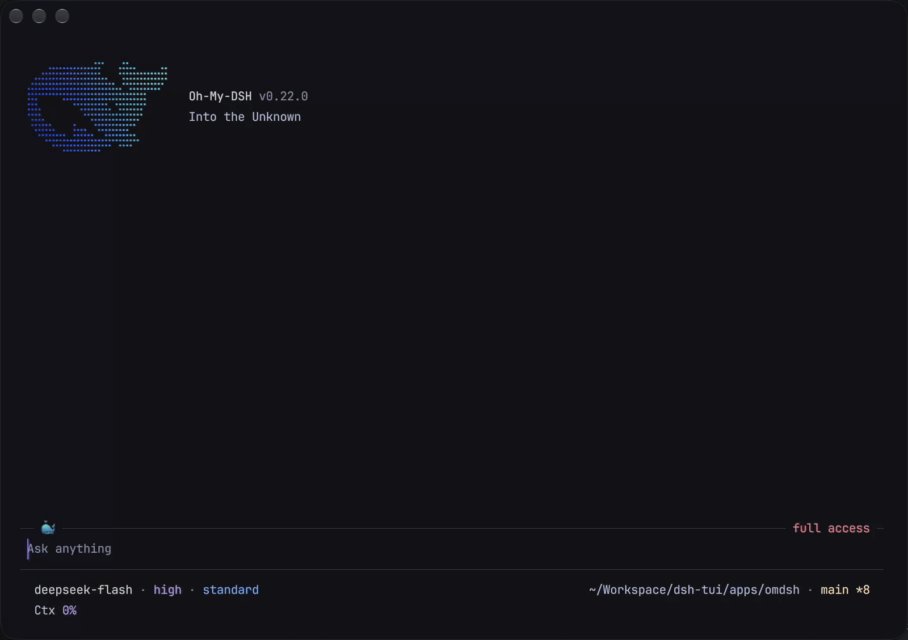

<div align="center">

# oh-my-dsh

**探索未至之境**

oh-my-dsh 致力于成为 [DeepSeek Harness](https://github.com/deepseek-ai/deepseek-harness) 的最佳 TUI 补充，在使用体验、交互和视觉品质上持续对齐 Harness，为终端带来美观、清晰、流畅的编程体验。项目构建于已发布的 Harness 插件运行时之上，以 `omdsh` 命令启动。

[](https://github.com/agi-fans/oh-my-dsh/actions/workflows/ci.yml) [](https://www.npmjs.com/package/@agi-fans/oh-my-dsh) [](https://www.npmjs.com/package/@agi-fans/oh-my-dsh) [](https://nodejs.org/) [](LICENSE)

[官方文档](https://omdsh.agi.fans/zh/) · [English](README.md) · 简体中文

</div>

[](apps/site/public/omdsh-demo.mp4)

这段约 26 秒的真实终端录像录制于 v0.22.0，展示了 omdsh 读取仓库 README 并回复，完成后将过程收起为 `Worked for 7s · Ctrl+O to expand`，再展开思考与工具行回顾执行过程。输入区与状态栏固定在底部，展示上下文占用、缓存命中率、首字延迟和输出速度。点击预览可查看全分辨率视频。

<!-- 用户于 2026-11-06 提供的实录素材 iShot_2026-11-06_19.46.27.mp4。画面显示 v0.22.0、deepseek-flash 和 high 推理强度。保留原始 MP4，1810 × 1276、30 fps、26.3 秒。GIF 与封面均从该录屏生成。 -->

## 快速开始

运行环境需要 Node.js 22.19 或更高的 22.x 版本，或者 Node.js 24 及更高版本；进行真实模型对话时还需要 DeepSeek 账户或 API Key。

```sh
npm install --global @agi-fans/oh-my-dsh
omdsh
```

进入 omdsh 后运行 `/login`，用 DeepSeek 账户登录或保存 API Key，再通过 `/model` 选择模型。账户登录请选择 `deepseek-account` 下的模型，随后即可发送请求。也可以用 `npx @agi-fans/oh-my-dsh` 临时体验。[第一个任务教程](https://omdsh.agi.fans/zh/docs/tutorials/first-task/) 会带你完成登录和一次项目检查。

## omdsh 的特色

- **工作过程清楚可读。** 思考和工具调用以紧凑行展示，键盘操作或点击展开箭头即可查看。完成后过程收起为耗时摘要，回复和失败信息继续可见，完整输入与结果也能随时查阅。
- **认真打磨终端视觉。** Markdown、代码、表格和 Diff 都有明确的留白与阅读层次。深浅配色分别基于 Catppuccin Mocha 和 Latte，并提供跟随终端颜色的 System 选项。排版兼顾中文和 emoji 的显示宽度。
- **键盘与鼠标配合。** 用按键导航、鼠标滚动与展开详情，选中文字复制，或引用到草稿中。阅读时输入区和状态栏固定在底部。
- **熟悉的 Harness 控制。** 使用 DeepSeek 账户或 API Key 登录，选择模型与推理强度，通过 Plan 模式调查任务，并为会话设置 Access。底层行为、可复用的 Skills、MCP 工具和 Agent 预设由 Harness 插件提供。
- **贯穿多轮工作的会话。** 附加文件与图片、排队后续请求、引导可继续的子智能体，搜索并恢复历史会话。随着任务推进，可以回退、压缩和导出，同时保留终端原生滚动历史。
- **按需查看完整细节。** 用 `/context` 检查上下文占用，`/trajectory` 回顾执行过程，`/diff` 阅读文件变更。可配置状态栏把需要的运行数据放在输入区旁。

## 如何阅读文档

从[教程导读](https://omdsh.agi.fans/zh/docs/tutorials/)开始，再按你的目标选择路线。

| 你想做什么 | 从这里开始 |
|---|---|
| 试用 omdsh 并看懂界面 | [完成第一个任务](https://omdsh.agi.fans/zh/docs/tutorials/first-task/)，再[调整工作环境](https://omdsh.agi.fans/zh/docs/tutorials/environment/) |
| 用于日常编程 | [提供精确上下文](https://omdsh.agi.fans/zh/docs/tutorials/precise-context/)、[引导运行中的任务](https://omdsh.agi.fans/zh/docs/tutorials/guide-a-turn/)、[管理长会话](https://omdsh.agi.fans/zh/docs/tutorials/long-session/) |
| 查找操作或排查问题 | [命令](https://omdsh.agi.fans/zh/docs/commands/)、[键盘与鼠标](https://omdsh.agi.fans/zh/docs/keyboard/)、[设置](https://omdsh.agi.fans/zh/docs/settings/)和[故障排查](https://omdsh.agi.fans/zh/docs/troubleshooting/) |
| 补充项目知识或能力 | [Skills 与 MCP](https://omdsh.agi.fans/zh/docs/tutorials/skills-and-mcp/)、[语言服务器](https://omdsh.agi.fans/zh/docs/language-servers/)和[用户插件](https://omdsh.agi.fans/zh/docs/plugins/) |
| 开发集成 | [编写插件](https://omdsh.agi.fans/zh/docs/tutorials/write-a-plugin/)、[插件内部机制](https://omdsh.agi.fans/zh/docs/plugin-internals/)和[架构](https://omdsh.agi.fans/zh/docs/architecture/) |

`apps/site/content/` 下的双语 Markdown 是文档内容源。发现问题或希望改进某项体验，可以通过 [Issue 表单](https://github.com/agi-fans/oh-my-dsh/issues/new/choose)反馈。

## 与 Harness 的关系

DeepSeek Harness 提供 Agent 运行时和“一切皆插件”的架构。omdsh 将这些已发布的软件包组合为社区维护的终端应用。Harness 负责会话、模型、工具、权限及其生命周期，omdsh 负责这些工作在终端中的阅读、导航与交互。

对齐意味着把熟悉的 Harness 概念与行为带入终端单元格、键盘输入和原生滚动历史的环境。omdsh 围绕这些约束发展自己的呈现方式，重视渐进展开、清晰阅读和一致操作。各功能参考页说明当前支持范围与限制。

## 架构

```text
DeepSeek Harness 插件与服务
             │
             ▼
 @agi-fans/dsh-tui — 终端能力边界
             │
             ▼
 @agi-fans/oh-my-dsh — 启动与插件组合
```

TUI 软件包拆分为 Service Definition、本地终端 Provider、会话与交互适配器、工具展示适配桥、命令贡献插件和交互式 Runner。这让终端所有权与 Harness 领域状态相互隔离，也只在能力拥有独立生命周期或所有者时公开插件边界。当前边界与数据流请参阅[架构概览](https://omdsh.agi.fans/zh/docs/architecture/)。

## 性能

性能优化覆盖会话回放、转录布局缓存、流式 Markdown 和长文件阅读。2026 年 11 月 6 日的 Apple M5 Pro CPU 基准中，10,000 轮生命周期投影的中位耗时为 2.567 ms，109,500 字符 Markdown 预览滚动为 0.383 ms，10,000 行源码阅读器横向平移为 0.212 ms。这些测量隔离了本地处理成本，不含模型延迟、磁盘 I/O 和终端绘制。

完整方法与限制请参阅可复现的 [TUI 性能报告](https://omdsh.agi.fans/zh/docs/performance/)，也可以在本地运行 `pnpm benchmark:tui`。

## 配置

运行 `/login` 可以配置一家提供方。DeepSeek 会打开官方 Key 管理页、验证 Key，并把它存入共享的 Harness 凭据库中的 `DEEPSEEK_API_KEY`；由环境变量提供、不可覆盖的值保持不变。可以在 `/login` 中登录 DeepSeek 账户：TUI 通过 loopback 回调接收浏览器授权，也会复用 DSH Web/Desktop 已建立的授权。之后 `deepseek-account` 路由会与 API Key 路由一同出现在 `/model`；登出可以在 `/logout` 或同一个账户入口中完成。当已挂载的提供方注册了 Harness 授权流程时，`/login` 会列出该流程及其方法，终端只渲染流程要求的通知和提问。同一条命令也可以激活 catalog API Key 提供方，或添加自定义提供方（自己的 id、Base URL、协议和模型 id）。`/logout` 只删除存储在文件中的凭据；环境变量可用时会回退到环境变量。

模型设置与其他插件配置都持久化到当前 Profile 的 Cordis 补丁 `$OMDSH_HOME/profiles/omdsh/cordis.patch.yml` 中；更早版本留下的 `settings.yaml` 会在启动时导入一次，并重命名为 `settings.yaml.imported`。使用 `/model favorite` 和 `/model unfavorite` 维护本地快速切换列表，再用 `Ctrl+P`/`Alt+P` 前后切换模型，使用 `Shift+Tab` 切换推理强度（`Ctrl+T` 控制思考内容的显示）。Skills 与 MCP 的配置方式请参阅 [Skills 与 MCP](https://omdsh.agi.fans/zh/docs/skills-and-mcp/)。

升级后，omdsh 可以在启动时只展示一次版本说明。使用 `/changelog` 查看近期条目，或使用 `/changelog full` 查看随包发布的完整历史。程序每天至多执行一次带缓存的 npm 版本检查，只提示新版本而不会自动安装；这两项行为都可以在 `/settings` 中调整。长任务完成和等待人工输入的终端通知也在这里配置，并且默认关闭。每一项设置、可选值与默认值见[设置](https://omdsh.agi.fans/zh/docs/settings/)。

以下命令不会启动 TUI 或访问网络，可直接生成 Shell 补全脚本：

```sh
omdsh completions bash
omdsh completions zsh
omdsh completions fish
```

## 开发

```sh
pnpm install
pnpm omdsh "list files"  # 从源码运行
pnpm typecheck           # 检查 TypeScript
pnpm test                # 单元测试与管道模式测试
pnpm build               # 构建全部 workspace 软件包
pnpm smoke               # 交互式 PTY 冒烟测试
pnpm smoke:happy         # 使用模拟 LLM 验证正常流程
```

`refs/deepseek-harness`、`refs/oh-my-pi` 与 `refs/pi` 中的代码是只读参考项目。开发 omdsh 时不要将它们用作运行时依赖，也不要修改其内容。

## 变更日志

面向用户的变更与版本发布记录统一维护在 [CHANGELOG.md](CHANGELOG.md) 中。

## 致谢

oh-my-dsh 的诞生离不开这些项目：

- [DeepSeek Harness](https://github.com/deepseek-ai/deepseek-harness) 提供了运行时基础、插件架构，以及 Agent 能力应当通过组合而非内嵌于单一应用中的设计信念。
- [Pi](https://github.com/earendil-works/pi) 是最初的开放式 Agent Harness，其终端交互、差分渲染和紧凑的 Coding Agent 工艺，至今仍是这个社区继续建设的基准。
- [oh-my-pi](https://github.com/can1357/oh-my-pi) 延续了这条脉络，并展示了细致的终端交互、紧凑的信息设计和精心设计的键盘工作流，如何让 Agent 既快速又易于使用。

感谢这些项目及其所有贡献者。omdsh 是一个独立的社区项目：它构建于 DeepSeek Harness 之上，并从 Pi 与 OMP 学习，但不是其中任何一个项目的官方发行版本。

## 许可证

oh-my-dsh 使用 [MIT License](LICENSE) 发布。
