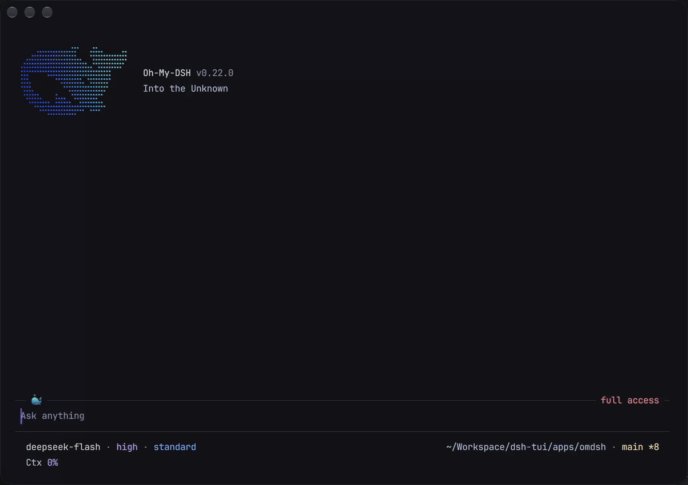

<!-- Generated from the repository README by scripts/sync-package-readme.mjs. -->

<div align="center">

# oh-my-dsh

**Into the Unknown**

oh-my-dsh aims to be the best TUI companion for [DeepSeek Harness](https://github.com/deepseek-ai/deepseek-harness). It brings Harness to the terminal with familiar behavior and interactions, careful visual design, and a focus on making everyday coding feel clear and fluid. Built on the published Harness plugin runtime, it runs as `omdsh`.

[](https://github.com/agi-fans/oh-my-dsh/actions/workflows/ci.yml) [](https://www.npmjs.com/package/@agi-fans/oh-my-dsh) [](https://www.npmjs.com/package/@agi-fans/oh-my-dsh) [](https://nodejs.org/) [](https://github.com/agi-fans/oh-my-dsh/blob/main/LICENSE)

[Documentation](https://omdsh.agi.fans/) · English · [简体中文](https://github.com/agi-fans/oh-my-dsh/blob/main/README.zh-CN.md)

</div>

[](https://github.com/agi-fans/oh-my-dsh/blob/main/apps/site/public/omdsh-demo.mp4)

A 26-second terminal recording shows omdsh reading the repository README and replying, folding the completed process into `Worked for 7s · Ctrl+O to expand`, then reopening the thinking and tool rows for review. The composer and footer stay at the bottom, showing context usage, cache hits, first-token latency, and token throughput. Click the preview for the full-resolution video.

<!-- User-recorded demo from iShot_2026-11-06_19.46.27.mp4, supplied on 2026-11-06. The video shows v0.22.0, deepseek-flash, and high reasoning. Original MP4 preserved at 1810 × 1276, 30 fps, 26.3 seconds. GIF and poster are derived from that recording. -->

## Quick start

Requirements: Node.js 22.19 or later in the 22.x line, or Node.js 24 or newer, plus a DeepSeek account or API key for live model turns.

```sh
npm install --global @agi-fans/oh-my-dsh
omdsh
```

Inside omdsh, run `/login` to sign in with a DeepSeek account or save an API key, then use `/model` to select your model. Account users choose a model under `deepseek-account`. Send a request to begin. You can also try `npx @agi-fans/oh-my-dsh` without a global installation. The [first-task tutorial](https://omdsh.agi.fans/docs/tutorials/first-task/) walks through sign-in and a project inspection.

## What makes omdsh different

- **A clear view of the work.** Thinking and tool calls begin as compact rows you can expand with the keyboard or a click on the disclosure arrow. Completed work folds into a duration summary, with replies and failure facts still visible. Full inputs and results are within reach.
- **Careful terminal design.** Markdown, code, tables, and diffs have deliberate spacing and visual hierarchy. Dark and light palettes adapt Catppuccin Mocha and Latte, with a System option to follow terminal colors. Layout accounts for CJK text and emoji.
- **Keyboard and mouse together.** Navigate with keys, scroll and open details with the mouse, select and copy text, or quote a selection into your draft. The composer and status footer stay anchored while you read.
- **Familiar Harness controls.** Sign in with a DeepSeek account or API key, choose a model and reasoning effort, investigate in Plan mode, and set Access for the session. Harness plugins supply the underlying behavior and reusable Skills, MCP tools, and agent presets.
- **A workflow that lasts beyond one turn.** Attach files and images, queue follow-ups, steer continuable child agents, and search or resume earlier sessions. Rewind, compact, and export as work grows, with native terminal scrollback preserved.
- **Details when you need them.** Inspect context usage in `/context`, the execution history in `/trajectory`, and changed files in `/diff`. A configurable footer keeps useful telemetry close to the prompt.

## Find your way through the docs

Start with the [tutorial guide](https://omdsh.agi.fans/docs/tutorials/), then follow the route that matches your work.

| You want to | Start here |
|---|---|
| Try omdsh and understand the interface | [Complete your first task](https://omdsh.agi.fans/docs/tutorials/first-task/), then [tune the working environment](https://omdsh.agi.fans/docs/tutorials/environment/) |
| Use it for everyday coding | [Give precise context](https://omdsh.agi.fans/docs/tutorials/precise-context/), [guide an active turn](https://omdsh.agi.fans/docs/tutorials/guide-a-turn/), and [manage long sessions](https://omdsh.agi.fans/docs/tutorials/long-session/) |
| Look up a control or diagnose a problem | [Commands](https://omdsh.agi.fans/docs/commands/), [keyboard and mouse](https://omdsh.agi.fans/docs/keyboard/), [settings](https://omdsh.agi.fans/docs/settings/), and [troubleshooting](https://omdsh.agi.fans/docs/troubleshooting/) |
| Add project knowledge or capabilities | [Skills and MCP](https://omdsh.agi.fans/docs/tutorials/skills-and-mcp/), [language servers](https://omdsh.agi.fans/docs/language-servers/), and [user plugins](https://omdsh.agi.fans/docs/plugins/) |
| Develop an integration | [Write a plugin](https://omdsh.agi.fans/docs/tutorials/write-a-plugin/), [plugin internals](https://omdsh.agi.fans/docs/plugin-internals/), and [architecture](https://omdsh.agi.fans/docs/architecture/) |

The bilingual Markdown under `apps/site/content/` is the documentation source of truth. To report a problem or suggest an improvement, use the [issue forms](https://github.com/agi-fans/oh-my-dsh/issues/new/choose).

## How it fits with Harness

DeepSeek Harness supplies the agent runtime and its “everything is a plugin” architecture. omdsh composes those published packages into a community terminal application. Harness owns sessions, models, tools, permissions, and their lifecycle. omdsh owns how you read, navigate, and interact with that work in a terminal.

Alignment means carrying familiar Harness concepts and behavior into the constraints of terminal cells, keyboard input, and native scrollback. omdsh develops its own presentation around those constraints, with progressive disclosure, readable output, and consistent controls as its priorities. Current coverage and limitations are documented in the feature references.

## Architecture

```text
DeepSeek Harness plugins and services
                │
                ▼
  @agi-fans/dsh-tui — terminal capability seam
                │
                ▼
  @agi-fans/oh-my-dsh — boot and plugin composition
```

The TUI package is split into a service definition, local terminal Provider, session and interaction adapters, tool-presentation bridge, command contributions, and interactive Runner. This isolates terminal ownership from Harness domain state and exposes plugin seams only where a capability has an independent lifecycle or owner. See the [architecture overview](https://omdsh.agi.fans/docs/architecture/) for the current boundaries and data flow.

## Performance

Performance work covers session replay, cached transcript layout, streaming Markdown, and long-file readers. In the November 6, 2026 Apple M5 Pro CPU benchmarks, a 10,000-turn lifecycle projection took a median 2.567 ms, scrolling a 109,500-character Markdown preview took 0.383 ms, and horizontal panning in a 10,000-line source reader took 0.212 ms. The measurements isolate local processing and exclude model latency, disk I/O, and terminal drawing.

See the reproducible [TUI performance report](https://omdsh.agi.fans/docs/performance/) or run `pnpm benchmark:tui` locally.

## Configuration

Run `/login` to configure a provider. DeepSeek opens the official key dashboard, validates the key, and stores it in the shared Harness credential store under `DEEPSEEK_API_KEY`; an environment-owned value is left untouched. A DeepSeek account can be signed in from `/login`: the TUI listens on a loopback callback for the browser flow and reuses any grant already established by DSH Web/Desktop. The account route (`deepseek-account`) then appears in `/model` beside the API-key route; sign-out is available from `/logout` or the same account prompt. When a mounted provider registers a Harness authorization flow, `/login` lists that flow and its methods and the terminal only renders the notices and prompts the flow asks for. The same command can also activate a catalog API-key provider or add a custom provider with its own id, base URL, protocol, and model ids. `/logout` removes only file-stored credentials and falls back to the environment when available.

Model settings and the rest of the plugin config persist into the active Profile's Cordis patch, `$OMDSH_HOME/profiles/omdsh/cordis.patch.yml`; a `settings.yaml` left by an earlier release is imported once at startup and renamed to `settings.yaml.imported`. Use `/model favorite` and `/model unfavorite` to maintain a small local cycle list, then use `Ctrl+P`/`Alt+P` to move through it and `Shift+Tab` to change reasoning effort (`Ctrl+T` toggles thinking visibility). Skills and MCP configuration are documented in [Skills and MCP](https://omdsh.agi.fans/docs/skills-and-mcp/).

After an upgrade, omdsh can show release notes once at startup. Use `/changelog` for recent entries or `/changelog full` for the complete packaged history. A cached daily npm check reports newer versions without installing anything automatically; both behaviors can be customized in `/settings`. Terminal notifications for completed long turns and human prompts are also configured there and remain off by default. Every setting, its allowed values, and its default are listed in [Settings](https://omdsh.agi.fans/docs/settings/).

Generate shell integration without starting the TUI or making network requests:

```sh
omdsh completions bash
omdsh completions zsh
omdsh completions fish
```

## Development

```sh
pnpm install
pnpm omdsh "list files"  # run from source
pnpm typecheck           # check TypeScript
pnpm test                # unit and pipe-mode tests
pnpm build               # build all workspace packages
pnpm smoke               # interactive PTY smoke test
pnpm smoke:happy         # mock-LLM happy path
```

The checkouts in `refs/deepseek-harness`, `refs/oh-my-pi`, and `refs/pi` are read-only references. Do not use them as runtime dependencies or modify them while developing omdsh.

## Changelog

User-visible changes and release history are tracked in [CHANGELOG.md](https://github.com/agi-fans/oh-my-dsh/blob/main/CHANGELOG.md).

## Acknowledgements

oh-my-dsh exists because of these projects:

- [DeepSeek Harness](https://github.com/deepseek-ai/deepseek-harness) provides the runtime foundation, plugin architecture, and the conviction that agent capabilities should be composable rather than embedded in one application.
- [Pi](https://github.com/earendil-works/pi) is the original open agent harness whose terminal interaction, differential rendering, and compact coding-agent craft still set the standard this community builds on.
- [oh-my-pi](https://github.com/can1357/oh-my-pi) continues that lineage and shows how thoughtful terminal interaction, compact information design, and careful keyboard workflows can make an agent feel fast and approachable.

Thank you to these projects and their contributors. omdsh is an independent community project: it is built on DeepSeek Harness and learns from Pi and OMP, but is not an official distribution of any of them.

## License

oh-my-dsh is available under the [MIT License](https://github.com/agi-fans/oh-my-dsh/blob/main/LICENSE).
